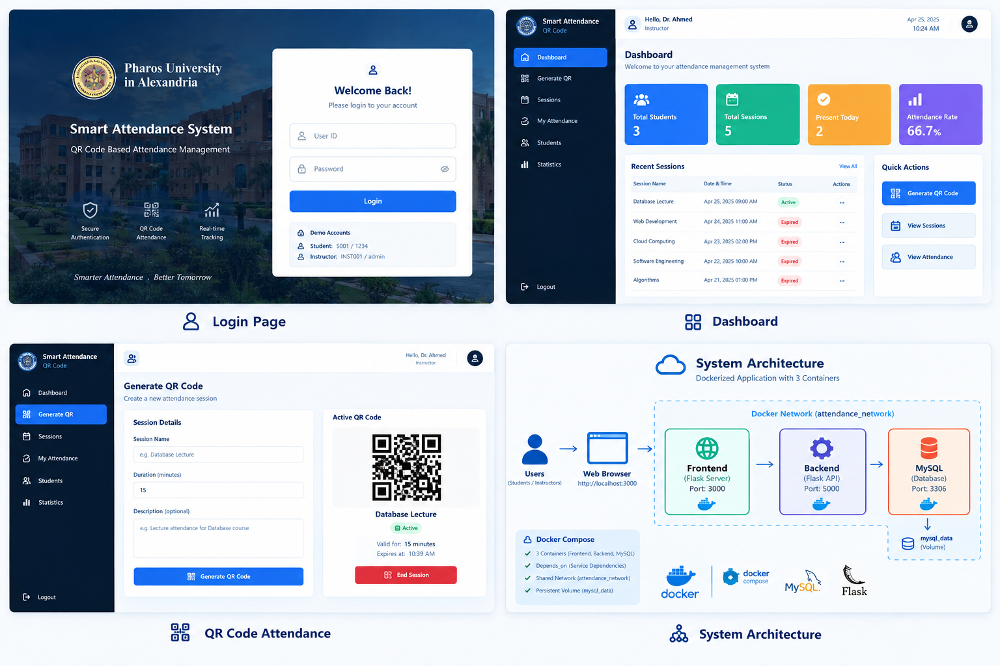

# 🎓 Smart Attendance System – QR Code

<p align="center">
  
</p>

<p align="center">
  <strong>🚀 Pharos University in Alexandria</strong>
  <br>
  📚 CS405 – Cloud Computing Project
  <br><br>
  <em>Smart Attendance • Seamless Tracking • Containerized Deployment</em>
</p>

<p align="center">
  
  
  
  
</p>

---

## 🌟 About the Project

The **Smart Attendance System – QR Code** is a web-based application designed to simplify university attendance management using QR code technology.

The system allows instructors to manage attendance sessions and generate QR codes, while students can check in and review their attendance records through a user-friendly web interface.

Built with **Python, Flask, MySQL, Docker, and Docker Compose**, this project demonstrates containerization, database integration, service communication, and cloud computing fundamentals.

### ✨ Key Features

- 🔐 **User Authentication** — Login functionality for students and instructors.
- 📱 **QR Code Attendance** — Simplified student check-in.
- 👨‍🏫 **Session Management** — Manage attendance sessions.
- 📊 **Attendance Reports** — Review student and session attendance records.
- 📈 **Statistics Dashboard** — Access general attendance statistics.
- 🗄️ **MySQL Database** — Store attendance-related information.
- 🐳 **Dockerized Deployment** — Run the application using Docker Compose.
- 💾 **Persistent Storage** — Preserve database files using Docker volumes.
- 🌐 **REST API** — Connect the frontend to the backend.
- 🔗 **Shared Network** — Enable communication between application containers.

---

## 🖥️ Application Preview

Explore the visual concept of the system, including its main interfaces and deployment architecture.

## 🖥️ Application Preview

<p align="center">
  
</p>

> 📝 **Note:** The image above is a visual design preview. The actual interface and features may differ depending on the implemented source code.

---

## ⚡ Quick Start

### 🛠️ Prerequisites

Make sure the following tools are installed:

- 🐳 [Docker Desktop](https://www.docker.com/products/docker-desktop/)
- 💻 Git (optional, for cloning the repository)

### 🚀 Run the Application

**Step 1:** Open a terminal in the project root directory.

**Step 2:** Build and start the application:

```bash
docker-compose up --build
```

**Step 3:** Wait for the services to initialize, then open your browser.

| Service | URL |
|---|---|
| 🌐 Frontend | http://localhost:3000 |
| ⚙️ Backend API | http://localhost:5000 |
| 🗄️ MySQL Database | Internal Docker service |

🎉 Your application is ready to test once all required services are running.

---

## 👥 Demo Accounts

Use the following credentials to test the application.

| Role | User ID | Password |
|---|---|---|
| 🎓 Student | `S001` | `1234` |
| 🎓 Student | `S002` | `1234` |
| 🎓 Student | `S003` | `1234` |
| 👨‍🏫 Instructor | `INST001` | `admin` |

🔒 **Security Note:** These credentials are intended for demonstration purposes only. Replace default credentials and implement secure password hashing before production deployment.

---

## 🏗️ System Architecture

The application is organized into three main services connected through a shared Docker network.

```text
                     🌐 WEB BROWSER
                           |
                           v
                  ┌──────────────────┐
                  │  FRONTEND 🌐     │
                  │  Flask Server    │
                  │  Port: 3000      │
                  └────────┬─────────┘
                           |
                           v
                  ┌──────────────────┐
                  │  BACKEND ⚙️      │
                  │  Flask REST API  │
                  │  Port: 5000      │
                  └────────┬─────────┘
                           |
                           v
                  ┌──────────────────┐
                  │  MYSQL DATABASE  │
                  │  Port: 3306      │
                  └────────┬─────────┘
                           |
                           v
                     💾 mysql_data

              🐳 Docker Network:
                attendance_network
```

### 📦 Application Services

| Service | Responsibility |
|---|---|
| 🌐 Frontend | Serves the web interface. |
| ⚙️ Backend | Handles API requests and application logic. |
| 🗄️ MySQL | Stores application data. |
| 💾 Docker Volume | Provides persistent database storage. |
| 🔗 Docker Network | Enables communication between containers. |

---

## 📂 Project Structure

```text
attendance-system/
│
├── 📄 README.md
├── 🐳 docker-compose.yml
│
├── 📁 docs/
│   └── 📁 images/
│       └── 🖼️ attendance-system-preview.png
│
├── ⚙️ backend/
│   ├── Dockerfile
│   ├── app.py
│   └── requirements.txt
│
└── 🌐 frontend/
    ├── Dockerfile
    ├── server.py
    ├── requirements.txt
    │
    ├── 📁 templates/
    │   └── index.html
    │
    └── 📁 static/
        ├── 📁 css/
        │   └── style.css
        │
        └── 📁 js/
            └── app.js
```

### 📌 Main Components

| File | Description |
|---|---|
| `docker-compose.yml` | Defines and orchestrates the application services. |
| `backend/Dockerfile` | Defines the backend container image. |
| `backend/app.py` | Implements the Flask REST API. |
| `backend/requirements.txt` | Lists backend Python dependencies. |
| `frontend/Dockerfile` | Defines the frontend container image. |
| `frontend/server.py` | Runs the frontend web server. |
| `frontend/templates/index.html` | Contains the main HTML page. |
| `frontend/static/css/style.css` | Defines the interface styling. |
| `frontend/static/js/app.js` | Handles frontend interactions and API requests. |
| `docs/images/attendance-system-preview.png` | Contains the README preview image. |

---

## 🐳 Docker & Cloud Computing Requirements

The project demonstrates the following containerization and orchestration concepts.

| # | Requirement | Implementation |
|---|---|---|
| 1️⃣ | Three containers | Frontend, Backend, and MySQL |
| 2️⃣ | Separate Dockerfiles | Frontend and Backend |
| 3️⃣ | Database container | MySQL service |
| 4️⃣ | Persistent storage | `mysql_data` volume |
| 5️⃣ | Service dependencies | `depends_on` |
| 6️⃣ | Shared network | `attendance_network` |
| 7️⃣ | Container orchestration | Docker Compose |
| 8️⃣ | Service communication | Docker networking |

💡 The actual service names, port mappings, volumes, and networking settings are defined in `docker-compose.yml`.

---

## 🗄️ Database Design

The system uses MySQL to organize and manage attendance information.

| Table | Description |
|---|---|
| 👨‍🎓 `students` | Stores student and account information according to the implemented schema. |
| 📱 `qr_codes` | Stores generated QR codes and associated expiration information. |
| 📋 `attendance_records` | Stores student attendance records for individual sessions. |

### 💾 Data Persistence

The named Docker volume `mysql_data` is intended to preserve database files beyond the lifecycle of individual containers.

⚠️ Removing the volume using `docker-compose down -v` can permanently delete the stored database data.

---

## 🔌 REST API Endpoints

The backend provides the following API endpoints.

| Method | Endpoint | Description |
|---|---|---|
| `POST` | `/api/login` | 🔐 Authenticate a user. |
| `POST` | `/api/logout` | 🚪 Log out a user. |
| `POST` | `/api/generate-qr` | 📱 Generate a QR code for an attendance session. |
| `POST` | `/api/checkin` | ✅ Process a student check-in. |
| `GET` | `/api/sessions` | 📚 Retrieve attendance sessions. |
| `GET` | `/api/session/:id/attendance` | 📋 Retrieve attendance for a specific session. |
| `GET` | `/api/student/:id/attendance` | 🎓 Retrieve a student's attendance history. |
| `GET` | `/api/stats` | 📊 Retrieve general attendance statistics. |

📌 Request formats, response structures, and authorization requirements depend on the implementation in `backend/app.py`.

---

## 🔄 How It Works

The attendance process follows these steps:

1. 🌐 The user opens the web application.
2. 🔐 The student or instructor logs in.
3. 👨‍🏫 The instructor generates a QR code for an attendance session.
4. 📱 The student scans the QR code.
5. ⚙️ The backend validates the check-in request.
6. ✅ The attendance record is saved in MySQL.
7. 📊 The instructor reviews attendance records and available statistics.

🔒 QR expiration, authorization, and duplicate check-in prevention should be enforced on the backend.

---

## 🧰 Useful Docker Commands

### 🚀 Start the Application

```bash
docker-compose up
```

### 🔨 Build and Start

```bash
docker-compose up --build
```

### ⚡ Run in the Background

```bash
docker-compose up --build -d
```

### 📦 Check Running Containers

```bash
docker-compose ps
```

### 📜 View All Logs

```bash
docker-compose logs
```

### 🔍 Follow Logs in Real Time

```bash
docker-compose logs -f
```

### ⚙️ View Backend Logs

```bash
docker-compose logs -f backend
```

### 🌐 View Frontend Logs

```bash
docker-compose logs -f frontend
```

### 🛑 Stop the Application

```bash
docker-compose down
```

### 🧹 Stop and Remove Database Volumes

```bash
docker-compose down -v
```

⚠️ **Warning:** The last command removes Compose-managed volumes, including `mysql_data` if configured as a Compose volume. Back up important data first.

---

## 🛠️ Troubleshooting

### 🔴 Port Already in Use

If ports `3000` or `5000` are occupied, stop the conflicting process or update the host port mappings in `docker-compose.yml`.

### 🗄️ Database Connection Issues

- Check the MySQL container logs.
- Verify the database credentials and configuration.
- Use the MySQL service name as the hostname from the backend container.
- Ensure the database is ready before processing requests.

### 🌐 Frontend Cannot Connect to the Backend

Check the API URL configured in the frontend. Browser-based requests generally require a host-accessible address, such as `http://localhost:5000`.

### 🔄 Rebuild After Changes

```bash
docker-compose up --build
```

---

## 🔐 Security Recommendations

For a more secure and production-ready application, consider implementing:

- 🔒 Secure password hashing.
- 🛡️ Authentication and authorization for protected endpoints.
- ⏱️ Server-side QR code expiration validation.
- 🚫 Duplicate attendance prevention.
- 🔑 Environment variables or a secrets manager for credentials.
- 🧹 Input validation and parameterized SQL queries.
- 🔐 HTTPS for production deployments.
- 📜 Audit logging and rate limiting.
- ❤️ Database health checks and backend retry logic.

*These are recommended improvements and should not be considered implemented unless verified in the source code.*

---

## 🎯 Project Objectives

- 🐳 Understand Docker containerization.
- ☁️ Apply cloud computing concepts.
- 🔗 Orchestrate multiple services using Docker Compose.
- ⚙️ Develop a Flask REST API.
- 🗄️ Integrate a MySQL database.
- 📱 Implement a QR-based attendance workflow.
- 💾 Configure persistent storage and container networking.
- 📊 Build a web-based attendance management system.

---

## 🎓 Academic Information

| Detail | Information |
|---|---|
| 🏛️ University | Pharos University in Alexandria |
| 📚 Course | CS405 – Cloud Computing |
| 💻 Project | Smart Attendance System – QR Code |
| 🐳 Deployment | Docker & Docker Compose |
| ⚙️ Backend | Python & Flask |
| 🗄️ Database | MySQL |

---

<p align="center">
  <strong>🚀 Smart Attendance. Smarter Campus. 🎓</strong>
  <br>
  <em>Developed as part of the CS405 – Cloud Computing course.</em>
</p>
